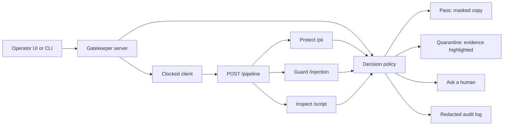

# Gatekeeper

Built for the Clocked Build Challenge 2026.

Gatekeeper is a safety airlock in front of an AI assistant or agent. An operator pastes an inbound message, an email, a retrieved page, or a script, or loads one of the built-in samples. Gatekeeper runs Clocked Protect, Guard, and Inspect, then makes a decision that changes what happens next.

| Decision | What happens |
| --- | --- |
| **Pass** | The assistant receives the masked copy. If Protect found nothing, that copy is the original text. |
| **Quarantine** | Nothing is released. Injection quotes or risky script lines are highlighted in the source. |
| **Ask a human** | Nothing is released. The probability sits in the uncertain band, the signals disagree, or a check came back incomplete. |

It is for platform teams and agent builders who need a review step before untrusted text reaches a model or a shell. A single "safe" flag is not enough: a retrieved page can redirect the assistant, a message can carry personal data into the next tool, and a script can be dangerous without being executed. Gatekeeper keeps the evidence next to the decision, and the decision changes the payload.

Personal data in the samples is fictional. The demo and the fixtures were recorded against the live Clocked API on 10 November 2026.

## How a screen works



The browser never sees the API key. The Node server holds `CLOCKED_API_KEY` and sends `Authorization: Bearer` plus a fresh `Idempotency-Key` (UUID v4) on every logical request. Retries of an unknown outcome reuse that same key and the same body.

One `POST https://clocked.rezolve.ai/clocked/pipeline` carries every check. Each step is that endpoint's own request and response. `on_error` is `continue`. No step sets `stop`, so a flagged Guard result cannot hide Inspect, and a failed step cannot hide the others. The policy, not the pipeline, makes the call. The worst outcome wins: quarantine, then ask a human, then pass.

## Endpoints

### Protect — `POST /pii`, pipeline step `protect`

Runs on every screen. The step asks for `anonymize: "mask"` with `mask_keep: 2`, over names (including Arabic), email, phone, address, date of birth, SSN, payment card, bank account, IP address, and a described `national_id` kind.

What changes:

- The entity list and `anonymized_text` choose the payload. A pass with findings forwards the masked copy, and the spans are highlighted on the source.
- A span with confidence under 0.60, a missing confidence, or a masked copy that still contains a finding holds the text for a person. The proposed mask is shown and is not released.
- A failed or missing Protect result holds the text. The raw source is not forwarded just because Guard was quiet.

On the recorded English email this found 8 spans and the pass forwarded the mask. On the Arabic message it found the name (twice), the email, the `+966` phone at confidence 0.66, and the fictional national id (returned as `ssn`). Offsets matched the source as Unicode code points.

### Guard — `POST /injection`, pipeline step `guard`

Runs on every screen, with evidence turned on. A direct message uses `source: "user"`. Email, retrieved pages, and scripts use `source: "content"`, because that text is data, not an instruction from the operator.

The threshold is 0.50. The uncertain band is 0.35–0.65. The injection probability, verdict, category, category distribution, severity, and evidence quotes all feed the decision:

- Inside the band, Gatekeeper asks a human, whatever the verdict. The recorded training note, which quotes an attack and says not to follow it, scored 0.44 with verdict benign and is held.
- Above the band, with an injection verdict and an attack category, it quarantines and highlights the quotes. The recorded vendor FAQ scored 0.997, category instruction override, severity critical, with four evidence quotes.
- Below the band, with a benign verdict, this axis clears. The recorded status email scored 0.003.
- A high injection score that disagrees with a benign category (at least 0.80 of the category mass) and comes back with no evidence span asks a human. An early draft of the benign email said "please book the room" as content and scored 0.77 with verdict injection, category benign at 0.99, severity none, and no evidence. The same words as a user message scored 0.002. Content that gives the assistant an order is a different question from a person asking, and a lone scalar is not a quarantine when the rest of the read says benign.
- A missing probability, a failed call, or a low score with a risky verdict asks a human. A high score with no verdict still quarantines.

### Inspect — `POST /script`, pipeline step `inspect`

Runs only when the intake is a script. Prose does not get a script judgment. The step describes the approved scope: read-only local diagnostics. Downloading and executing remote code, credential harvesting, persistence, and destructive commands are out of scope.

`malicious` and `suspicious` are both read. The decision uses the higher one, with the same band and the same verdict rules as Guard. Evidence lines are highlighted. A benign verdict on a read-only `lpstat` script clears it (recorded malicious about 0.004). The sketchy installer is quarantined on Inspect (malicious 0.996, category unsafe download or remote code execution) even though Guard for that same text sat in the uncertain band at 0.38 with verdict benign. That is why the pipeline does not stop after Guard.

A failed or missing Inspect result blocks a pass. A script is not cleared because the other two checks were quiet.

## Uncertain, missing, and failed results

| Situation | What Gatekeeper does |
| --- | --- |
| Probability inside 0.35–0.65 | Ask a human. Nothing is released. |
| Verdict and probability disagree | Ask a human. |
| Injection score is high, category is benign, and there is no evidence span | Ask a human. |
| Protect confidence under 0.60, or the mask still contains a finding | Ask a human. The proposed mask stays on screen. |
| A required check is missing or failed | Ask a human, unless another check already quarantines. A pass needs Protect and Guard, and Inspect when the intake is a script. |
| HTTP 408, 429, 500, 502, 503, 504, a network error, or a timeout | Up to 3 attempts, same Idempotency-Key, same body, backoff 200ms, 600ms, then 1400ms, plus a capped `Retry-After` when one is present. |
| `retryAsNew: true`, or 400, 401, 402, 403, 413, 422 | Stop. Surface the status. Do not open a second logical request by itself. |
| 409 without `retryAsNew` | Retry the same key. The attempt may still be in flight. |
| Empty text, unknown kind, or more than 60,000 characters | Rejected locally. Protect and Guard admit 60,000 characters, so the airlock uses that cap. |

A browser timeout is not treated as proof that Clocked stopped. The server keeps the original key across its own retries. Drills for timeout, a flaky 500, a 401, and a Guard step that fails inside an HTTP 200 run only in fixture mode, so they cannot spend credits. The audit log stores the decision, probabilities, categories, and span counts. It does not store raw findings or the source text.

## Fixture mode and live mode

Live mode is the default whenever `CLOCKED_API_KEY` is set. Fixture mode is the default when it is not, and `CLOCKED_MODE=fixture` forces it even if a key is present.

Built-in samples in fixture mode replay the recorded live responses in `fixtures/recorded/`. Those files are real `clocked-1.0` pipeline responses (fake personal data only). Other text uses a labeled offline stand-in: deterministic rules shaped like the same response schema, clearly marked in the UI as not a Clocked model read. The stand-in exists so the page still works without a key. It is not a substitute for the recorded samples or for live mode.

## Run it

Requires Node.js 20 or newer.

```bash
git clone https://github.com/barood-labs/clocked-gatekeeper.git
cd clocked-gatekeeper
npm test
npm start
```

Open http://127.0.0.1:8787

Live mode:

```bash
export CLOCKED_API_KEY=your_key_here
npm start
```

Force the recorded fixtures while a key is present:

```bash
CLOCKED_MODE=fixture npm start
```

CLI, from the same directory. Exit codes are 0 for pass, 3 for ask a human, 4 for quarantine, and 1 for a bad invocation.

```bash
node cli.js samples
node cli.js scan --sample pii-email
node cli.js scan --kind email --file note.txt
node cli.js scan --kind message --text "Please book a room tomorrow."
node cli.js batch --samples
node cli.js scan --sample borderline-note --json
```

`--json` is the operator view and includes findings. The default text output does not print raw personal values. The key is read from the environment and is never printed.

Record a 1280×720 live walkthrough (Chrome, and `CLOCKED_API_KEY` set). This spends a few credits:

```bash
npm start
npm run demo
```

Re-record the fixtures after a contract change (this calls the live API):

```bash
node scripts/record-fixtures.js
node scripts/record-fixtures.js --only arabic-pii
```

## Tests

```bash
npm test
```

The suite covers the decision matrix and the uncertain band, Unicode code-point highlighting (Arabic and emoji), mask behavior, the pipeline body (Protect, Guard, and Inspect, with `stop` left off), idempotent retries, terminal errors, `retryAsNew`, timeouts, fixture-mode decisions for every sample, replay of the recorded responses including offset checks, audit redaction, and the HTTP server. Tests do not call Clocked. CI runs the same command on Ubuntu with Node 22.

## Samples

| Id | Intake | Recorded result |
| --- | --- | --- |
| `benign-email` | Status note, no personal data | Pass, original text |
| `pii-email` | Fictional employee details | Pass, masked copy, 8 spans |
| `injection-page` | Vendor FAQ with a hidden instruction | Quarantine, evidence highlighted |
| `benign-script` | `lpstat` only | Pass, Inspect clear |
| `sketchy-script` | Remote install, credential, cron, `chmod 777` | Quarantine from Inspect |
| `arabic-pii` | Arabic support note, fictional name and phone | Pass, masked copy, right to left |
| `borderline-note` | Training email that quotes an attack | Ask a human, injection 0.44 |

The UI has an English / Arabic control. Sample text in Arabic renders right to left even when the chrome is English.

## Layout

```
src/server.js        HTTP API and static UI
src/screen.js        Orchestrates a screen
src/pipeline.js      Pipeline request and response normalization
src/policy.js        Pass / quarantine / ask
src/clocked.js       Bearer auth, idempotency, bounded retries
src/standin.js       Labeled offline stand-in
fixtures/recorded/   Live responses for the built-in samples
cli.js               Scan, batch, and serve
```

## License

MIT. See [LICENSE](LICENSE).

Built for the Clocked Build Challenge 2026.
